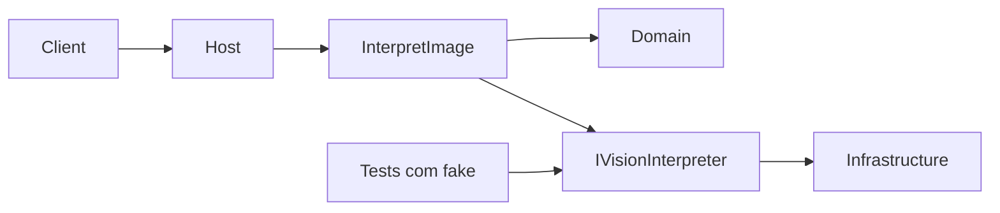

# API v1 em entregas pequenas

O contrato já está fechado em [docs/specs/003-api-contracts.md](docs/specs/003-api-contracts.md) e [docs/specs/005-acceptance-criteria.md](docs/specs/005-acceptance-criteria.md). O código de hoje é o template: [ImageInterpreter/Program.cs](ImageInterpreter/Program.cs) registra controllers e OpenAPI, e [ImageInterpreter/Controllers/WeatherForecastController.cs](ImageInterpreter/Controllers/WeatherForecastController.cs) continua. Esse endpoint de template permanece. As specs não mudam nesta implementação.

Duas decisões desta entrega:

- Projetos separados, para a direção de dependência valer na compilação. O host continua sendo [ImageInterpreter/ImageInterpreter.csproj](ImageInterpreter/ImageInterpreter.csproj). Novos projetos irmãos na raiz: `ImageInterpreter.Domain`, `ImageInterpreter.Application`, `ImageInterpreter.Infrastructure`, `ImageInterpreter.Tests`, todos `net10.0`, registrados em [ImageInterpreter.slnx](ImageInterpreter.slnx).
- Nenhum vendor. Infrastructure implementa `IVisionInterpreter` com um adaptador que não chama modelo e conclui como indisponível. O caminho `200` / `422` é provado nos testes, trocando o port por um fake. Um provider real fica para um ADR futuro e não altera o HTTP.

Ordem de checagem no `POST`, como na spec 003: autenticação, autorização, corpo, e só então o port.

## Entrega 1 — Domínio

Projetos e tipos imutáveis de [docs/specs/001-domain-model.md](docs/specs/001-domain-model.md): `Confidence`, `DetectedObject`, `ExtractedTextSpan`, `ModelIdentity`, `Interpretation`.

- Domain não referencia ASP.NET nem SDK de modelo.
- Fábricas recusam valor fora de 0–1, NaN, infinito, `summary` / `label` / `text` / `provider` / `name` só com espaço, e null. `description` vazio é válido. Listas vazias são válidas. Labels duplicados são válidos. O agregado não carrega bytes da imagem.
- `id` é `Guid`, atribuído pela aplicação, não pelo adaptador.
- Testes de unidade das invariantes no projeto de testes. Ainda não há `AC-00N`: os critérios são HTTP.

Pronto quando `dotnet build` compila os cinco projetos e as invariantes falham na construção.

## Entrega 2 — Caso de uso

Em Application, a porta e o caso de uso da spec 000.

- `IVisionInterpreter` recebe `mediaType` e os bytes. Não usa `IFormFile`, `HttpContext` nem tipo de vendor.
- Três desfechos: resultado de visão (rascunho com strings e números, ainda sem `id`), uninterpretable, unavailable.
- `InterpretImage` gera o `id`, chama a porta e constrói `Interpretation`. Se a construção quebra a invariante, o desfecho é unavailable e nenhum documento sai. Uninterpretable e unavailable não constroem `Interpretation`.
- O fake fica em `ImageInterpreter.Tests`. Nenhum teste chama modelo nem banco.

Testes de unidade dos três desfechos e da falha de invariante. Sem HTTP ainda.

## Entrega 3 — Problemas e rotas que não são a operação

Catálogo RFC 7807 da spec 003, com os URNs `urn:imageinterpreter:problem:...`, `title`, `detail` e `status` literais. O exemplo `about:blank` da regra de API não vale aqui; a spec 003 é o contrato.

- `Content-Type: application/problem+json`.
- `instance` é o path do request.
- `detail` não inclui token, bytes, stack nem payload de provider.
- `GET`, `PUT`, `PATCH`, `DELETE` e `HEAD` em `/api/v1/interpretations` respondem `405`, `Allow: POST` e o problema `method-not-allowed`.
- Qualquer método em `/api/v1/interpretations/{id}` responde `404` e `not-found`, com `instance` igual àquele path.
- Essas rotas não exigem token. `[Authorize]` fica só no `POST`.

Critérios: AC-030.

`public partial class Program` no host, para o `WebApplicationFactory` dos testes.

## Entrega 4 — JWT e escopo

Resource server da decisão de autenticação e do [docs/adr/0001-use-jwt-authentication.md](docs/adr/0001-use-jwt-authentication.md). Pacote `Microsoft.AspNetCore.Authentication.JwtBearer` na linha 10.0.x já usada pelo OpenAPI.

- RS256. Validar issuer, audience, assinatura e expiração.
- Configuração `Authentication:Issuer`, `Audience`, `ClockSkew` (explícito; não deixar o default da biblioteca implícito) e uma das chaves públicas: `JwksUri` ou `PublicKeyPem`. Sem uma delas, o host não sobe. Nenhuma chave privada, token ou `.env` no repositório. Os testes geram o par RSA em memória e assinam JWTs só no fixture.
- `UseAuthentication` antes de `UseAuthorization`.
- Claim `scope`: string separada por U+0020; espaços repetidos são um separador; tokens vazios são ignorados; comparação ordinal e case-sensitive com `interpretations:write`. Outros scopes no mesmo claim passam. Ausente, `""`, tipo que não é string, ou `interpretations:WRITE` é `403`.
- Corpos e `WWW-Authenticate` customizados nos eventos do JWT, porque o middleware padrão não emite o catálogo:
  - sem header, ou scheme diferente de `Bearer`: `401`, `WWW-Authenticate: Bearer`, detail `A bearer token is required.`
  - Bearer presente e recusado (vazio, assinatura, issuer, audience, expirado): `401`, `error="invalid_token"`, detail `The bearer token was not accepted.`
  - token aceito sem o scope: `403`, `error="insufficient_scope"` e `scope="interpretations:write"`.
- Falha de autenticação continua `401` mesmo sem o scope. O port não é chamado.

Critérios: AC-009, AC-010, AC-011, AC-012, AC-034.

## Entrega 5 — Validação do arquivo

No host, antes de `InterpretImage`. A primeira regra `400` que casar vence, na ordem do catálogo.

- `Content-Type` do request ausente ou diferente de `multipart/form-data` → `400` (`Content-Type must be multipart/form-data.`). Não deixar o framework responder `415`.
- Parte `image` ausente, ou presente e não sendo arquivo → `400` (um file field named image).
- Qualquer outra parte de arquivo, inclusive um segundo `image` → `400` (exactly one file field).
- Parte de arquivo com tamanho 0 → `400` (`The image file is empty.`).
- Campos que não são arquivo são ignorados. O nome do arquivo é ignorado.
- Tamanho do conteúdo do arquivo: 10.485.760 aceito; 10.485.761 → `413` com detail `The image is larger than 10 MB.` Limite de leitura do corpo: 10.485.760 + 65.536 bytes de overhead. Rejeição do Kestrel no meio da leitura também vira esse mesmo problema `413`.
- Assinatura conferida na Api, sem decodificar a imagem:
  - JPEG: `FF D8 FF`
  - PNG: `89 50 4E 47 0D 0A 1A 0A`
  - WebP: `RIFF` nos bytes 0–3 e `WEBP` nos bytes 8–11
- `Content-Type` da parte ausente, vazio ou `application/octet-stream`: classificar pela assinatura; senão `415`.
- `image/jpeg`, `image/png` ou `image/webp`: a assinatura tem de bater; divergência ou arquivo curto demais → `415`.
- Qualquer outro tipo, inclusive `image/jpg`, `image/gif` e `image/pjpeg` → `415`.
- Arquivo aceito chama `InterpretImage`. Com o adaptador padrão, isso responde `503` do catálogo. `400`, `401`, `403`, `413` e `415` não chamam o port.

Critérios: AC-013, AC-014, AC-015, AC-016, AC-018, AC-019, AC-020, AC-022, AC-035.

## Entrega 6 — Documento, 422, 503 e OpenAPI

Serializar `Interpretation` na borda HTTP, com os nomes da spec 004 (`id`, `summary`, `objects`, `extractedText`, `confidence`, `model`). Sem propriedades extras. `id` em hexadecimal minúsculo com hífens. `confidence` como número JSON; `0` e `1` são válidos.

- Resultado válido → `200` e `application/json`. O documento é a raiz, sem envelope.
- Uninterpretable → `422`, `application/problem+json`, sem `summary`, `objects` ou `extractedText`.
- Unavailable, timeout, ou resultado que não constrói (confiança `1.1`, summary só com espaço, mensagem crua de provider) → `503` com detail fixo `The image interpreter is unavailable.`
- Cada sucesso gera um `id` novo. Repetir o upload não cria recurso: `GET` desse `id` continua `404`.
- Query string ignorada.
- OpenAPI de Development descreve `POST /api/v1/interpretations` com o mesmo path, campos e status. A spec 003 continua mandando se os dois divergirem.
- Atualizar a seção "Current status" de [README.md](README.md) para o que o host realmente faz: contrato implementado, adaptador sem vendor, `GET /WeatherForecast` ainda presente.

Critérios que fecham aqui: AC-001 a AC-008, AC-017, AC-021, AC-023 a AC-029, AC-031, AC-032, AC-033, e o restante de AC-028.

Cada teste de critério leva `AC-00N` no nome, um critério por teste, e o modelo só através do fake. `dotnet test` na raiz é o critério de pronto de cada entrega.