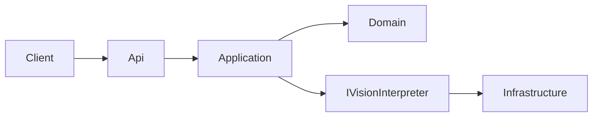

# Specification 000 — Overview

| | |
| --- | --- |
| Product | ImageInterpreter |
| Status | Active |
| Version | v1 |
| Date | 2026-11-05 |

## Purpose

ImageInterpreter is an HTTP API that accepts one image and returns a generic interpretation document: a summary, the objects it detected, the text it read, and confidence scores. v1 is stateless (no database). The caller receives the document in the response and the API keeps no copy.

The product operation is `POST /api/v1/interpretations`. The vision provider sits behind the port `IVisionInterpreter`. No vendor is chosen, and this delivery adds no provider ADR. Infrastructure is the only layer that implements the port. Swapping a provider later leaves the HTTP contract and the domain model unchanged.

These specifications are the source of truth for that behavior. They are written in English.

## Stack

v1 runs on **.NET 10** and **ASP.NET Core** (`net10.0`).

The host uses controller-based HTTP endpoints. The template already registers controllers and the development OpenAPI document (`AddControllers`, `AddOpenApi`, `MapControllers`). The product route lives under `/api/v1`. When the endpoint is implemented, that OpenAPI document must describe the same operation this specification set defines.

The repository today is still the single web project `ImageInterpreter/`. The layers below are the target architecture. Code may live in one project or several, provided the dependency direction holds.

## Reading order

Read the specifications in this order, then the authentication decision, then the architecture decision record:

1. [001-domain-model.md](001-domain-model.md) — `Interpretation`, detected objects, extracted text spans, and confidence.
2. [002-user-stories.md](002-user-stories.md) — API-client stories (`US-001` onward).
3. [003-api-contracts.md](003-api-contracts.md) — `POST /api/v1/interpretations`, including the `scope` wire format and RFC 7807 errors.
4. [004-data-model.md](004-data-model.md) — the canonical interpretation document. v1 has no other stored data.
5. [005-acceptance-criteria.md](005-acceptance-criteria.md) — Given/When/Then criteria (`AC-001` onward), each traced to a story.
6. [decisions/2026-11-05-authentication.md](decisions/2026-11-05-authentication.md) — product requirement: every interpretation call requires a JWT; the API is a resource server; the token must include `interpretations:write`.
7. [../adr/0001-use-jwt-authentication.md](../adr/0001-use-jwt-authentication.md) — ADR 0001: why the mechanism is JWT Bearer.

The decision states what the product requires. The ADR states the mechanism. The HTTP contract in spec 003 states the header, the `scope` claim on the wire, and the status codes. Specs 000–005 link to those two documents and do not restate the JWT decision.

## Goals

- Accept one image on `POST /api/v1/interpretations` and return one generic JSON document.
- Keep the field names stable: `id`, `summary`, `objects`, `extractedText`, `confidence`, and `model`.
- Keep v1 stateless. The `id` is a correlation UUID for that response.
- Protect the operation with a bearer token whose `scope` includes `interpretations:write`.
- Return failures as RFC 7807 problem details with the status codes in spec 003.
- Depend on a vision provider only through `IVisionInterpreter`, implemented only in Infrastructure.
- Trace each acceptance criterion in spec 005 to a user story in spec 002.

## Out of scope

- Choosing a vision vendor, and writing a provider ADR. This delivery does neither.
- Persistence of images, interpretations, or correlation ids. History or storage would be a future ADR.
- User registration, sign-in, token issuance, and refresh tokens. The authentication decision places v1 in the resource-server role.
- More than one image per request, image URLs, batch jobs, webhooks, and callbacks.
- Bounding boxes, polygons, or a required language field.
- A vendor-specific response shape. `model.provider` and `model.name` are opaque strings on the generic document.
- Removing the template endpoint described below. A later implementation may remove it.

## Target architecture

| Layer | Responsibility |
| --- | --- |
| Client | Sends one multipart image and reads the JSON document or a problem response. |
| Api | Authenticates the caller, authorizes `interpretations:write`, validates the file, and maps the HTTP contract. |
| Application | Runs the `InterpretImage` use case. Depends on the domain and on `IVisionInterpreter`. |
| Domain | `Interpretation`, detected objects, extracted text spans, and confidence. |
| Infrastructure | The only implementation of `IVisionInterpreter`, and the only layer that calls a model. |

Dependency direction:

- Api depends on Application (`InterpretImage`). Request handling does not call a model SDK and does not depend on a concrete adapter.
- Application depends on Domain and on the port `IVisionInterpreter`.
- Domain depends on neither Api, Application, Infrastructure, ASP.NET Core, nor a model SDK.
- Infrastructure depends inward and implements `IVisionInterpreter`. No other layer implements that port.
- The host's composition root may bind `IVisionInterpreter` to the Infrastructure adapter. That registration is the only reason the host mentions the adapter.

`InterpretImage` receives an image the Api layer has already accepted: a media type of `image/jpeg`, `image/png`, or `image/webp`, and between 1 and 10,485,760 bytes. It assigns a new correlation `id`, calls `IVisionInterpreter`, and builds an `Interpretation`.

The port accepts `mediaType` and the image bytes. It completes with one of three outcomes:

| Outcome | Meaning | HTTP result |
| --- | --- | --- |
| Vision result | `summary`, `objects`, `extractedText`, `confidence`, and `model` | `200` with the interpretation document |
| Uninterpretable | The file was accepted and the interpreter cannot interpret that content | `422` |
| Unavailable | The interpreter cannot be reached, times out, or returns a result that breaks domain invariants | `503` |

Application supplies `id`. The port does not choose it. The vision result uses the domain values `DetectedObject`, `ExtractedTextSpan`, `Confidence`, and `ModelIdentity`. The port signature uses none of the ASP.NET Core types and none of a vendor SDK's types. Spec 001 defines those domain values. Spec 003 defines the HTTP mapping.

## Template endpoint

The existing WeatherForecast template endpoint is not part of the product and stays until a later implementation. The template controller still answers `GET /WeatherForecast`. This specification set does not define that payload, does not require clients to call it, and does not remove it.

## Field names

Every spec uses these names for the interpretation document. Spec 004 is the schema. Spec 003 is the HTTP envelope around it.

| Name | Where it appears |
| --- | --- |
| `id` | Correlation UUID assigned for the response. |
| `summary` | Interpretation summary. |
| `objects` | Detected objects, in interpreter order. |
| `objects[].label` | Object label. |
| `objects[].confidence` | Confidence for that object. |
| `objects[].description` | Object description. May be an empty string. |
| `extractedText` | Extracted text spans, in interpreter order. |
| `extractedText[].text` | Text read from the image. |
| `extractedText[].confidence` | Confidence for that span. |
| `confidence` | Overall confidence of the interpretation, from 0 to 1 inclusive. |
| `model.provider` | Opaque provider identifier reported with the result. |
| `model.name` | Opaque model name reported with the result. |

The request carries one file field named `image`. The required scope is `interpretations:write`.

## Normative language

**Must** and **required** name rules that an implementation follows. The bicycle JSON in specs 003 and 004 is a sample of a valid document, not the only text a model may return.
