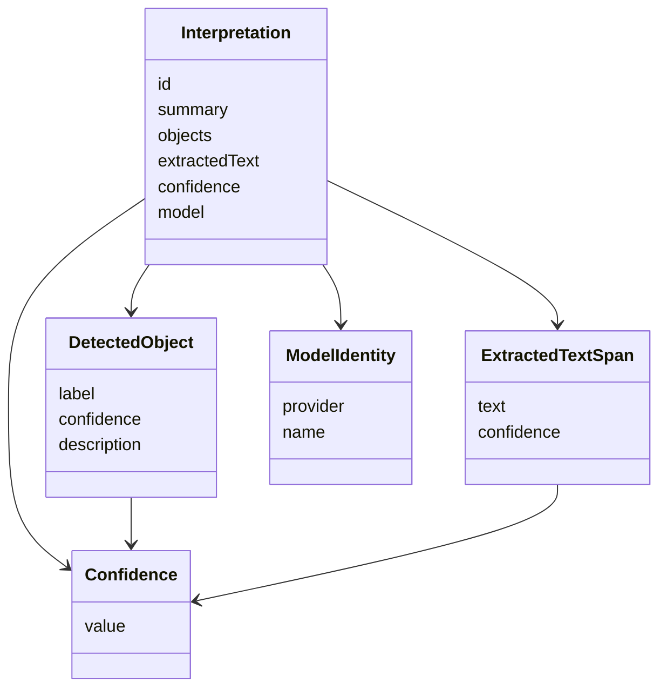

# Specification 001 — Domain model

| | |
| --- | --- |
| Product | ImageInterpreter |
| Status | Active |
| Version | v1 |
| Date | 2026-11-05 |

The domain describes a generic image interpretation. It is the model behind the document in [004-data-model.md](004-data-model.md). Field names here are the document field names.

The domain uses its own types and plain values: strings, numbers, ordered lists, and a UUID. It does not reference ASP.NET Core types (`IFormFile`, `HttpContext`, `ControllerBase`, `ProblemDetails`, and the rest of that stack) or types from a model-vendor SDK.

## Types

`Interpretation` is the aggregate. The other four types are values with no identity of their own. An `Interpretation` is identified by `id`. All five are immutable after construction.

### Interpretation

| Field | Meaning |
| --- | --- |
| `id` | Correlation UUID for this interpretation. Application assigns it. The vision adapter does not. |
| `summary` | Prose summary of the image. |
| `objects` | Ordered list of `DetectedObject`. The list may be empty. Order is the order the interpreter returned. |
| `extractedText` | Ordered list of `ExtractedTextSpan`. The list may be empty. Order is the order the interpreter returned. |
| `confidence` | Overall confidence of this interpretation. |
| `model` | `ModelIdentity` reported with the result. |

The aggregate does not carry the image bytes, a file name, a content type, or a storage location.

### DetectedObject

One object the interpreter detected.

| Field | Meaning |
| --- | --- |
| `label` | Short name of the object. |
| `confidence` | Confidence that this object is present as described. |
| `description` | Additional prose. The empty string is valid. |

Two objects may share a `label`. v1 attaches no bounding box and no polygon.

### ExtractedTextSpan

One fragment of text read from the image. A span is a piece of text, not a geometric region. v1 attaches no coordinates and no language code.

| Field | Meaning |
| --- | --- |
| `text` | The characters read from the image. |
| `confidence` | Confidence in that reading. |

### Confidence

A single closed range, shared by `Interpretation.confidence`, `DetectedObject.confidence`, and `ExtractedTextSpan.confidence`.

| Rule | Requirement |
| --- | --- |
| Range | `value` is a real number from 0 to 1 inclusive. |
| Endpoints | 0 and 1 are valid. |
| Rejected | Values below 0, values above 1, and non-numbers (including NaN and infinities) cannot be constructed. |

The overall `confidence` is the interpreter's confidence in the interpretation as a whole. The domain does not define it as an average of the other scores.

### ModelIdentity

Opaque metadata. The domain does not catalog vendors and does not branch on these strings.

| Field | Meaning |
| --- | --- |
| `provider` | Identifier the adapter reports for the provider. |
| `name` | Identifier the adapter reports for the model. |

## Invariants

Construction of an `Interpretation` enforces all of the following. A value that breaks one of them is not an `Interpretation`.

1. `id` is a UUID.
2. `summary` contains at least one non-whitespace character. Leading and trailing whitespace that surrounds other characters is kept.
3. `objects` and `extractedText` are present lists. They may be empty. They are not null.
4. Each `label` and each `text` contains at least one non-whitespace character.
5. Each `description` is a string. It may be empty.
6. Every `confidence` is a `Confidence` in the closed range from 0 to 1.
7. `model.provider` and `model.name` each contain at least one non-whitespace character.
8. No field is null.
9. The aggregate does not contain the uploaded image.

Duplicate labels are allowed. List order is significant and is preserved. v1 sets no maximum length on `summary`, `label`, `description`, `text`, `provider`, or `name`.

## Mapping to the document

The document in [004-data-model.md](004-data-model.md) is a direct serialization of one `Interpretation`. Names are not renamed on the way out.

| Domain | Document |
| --- | --- |
| `Interpretation.id` | `id` |
| `Interpretation.summary` | `summary` |
| `Interpretation.objects` | `objects` |
| `DetectedObject.label` | `objects[].label` |
| `DetectedObject.confidence` | `objects[].confidence` |
| `DetectedObject.description` | `objects[].description` |
| `Interpretation.extractedText` | `extractedText` |
| `ExtractedTextSpan.text` | `extractedText[].text` |
| `ExtractedTextSpan.confidence` | `extractedText[].confidence` |
| `Interpretation.confidence` | `confidence` |
| `ModelIdentity.provider` | `model.provider` |
| `ModelIdentity.name` | `model.name` |

`confidence` serializes as a JSON number. The numeric value is what matters.

## Outside the domain

`IVisionInterpreter` is an application port. It is not a domain type. Only Infrastructure implements it. The port's signature uses `mediaType`, image bytes, and the domain values above. It does not use ASP.NET Core types or a vendor SDK type.

`InterpretImage` is the application use case. It assigns `id`, calls the port, and constructs `Interpretation`. Three port outcomes are visible to the use case:

| Outcome | What Application does |
| --- | --- |
| Vision result whose fields satisfy the invariants | Builds `Interpretation` with the `id` it assigned and returns it. |
| Vision result that fails construction | Treats the call as unavailable. The broken value is not returned. |
| Uninterpretable | Returns that outcome. No `Interpretation` is built. |
| Unavailable | Returns that outcome. No `Interpretation` is built. |

Image bytes, multipart parsing, HTTP status codes, and authentication are outside the domain. Api owns HTTP. Spec 003 maps the use-case outcomes onto status codes.

## Related documents

- [000-overview.md](000-overview.md) — layers and the port.
- [004-data-model.md](004-data-model.md) — normative JSON schema for this model.
- [003-api-contracts.md](003-api-contracts.md) — HTTP contract that serializes an `Interpretation`.
